  寝坊ロケット / Nebou Rocket · Graduate student in Japan 
  Right now I'm into <b>space</b> 🌌 and <b>AI</b> 🧠

  

  🌐 <a href="https://muse.ai/s/purohuirusaito-xkxu6xzxyaxkxe20o/k8JmtGRf9bVtSMh8s4dY7Gr5s7aQnqICtlvgHFSRIcA">Profile Site</a> — about me, my work, and selected writing (EN / 日本語)

  🧩 <a href="https://github.com/nebourocket/powerpoint_viewer_extension">PowerPoint Viewer</a> ·
  <a href="https://github.com/nebourocket/kindle-highlights">Kindle Highlights</a> ·
  <a href="https://github.com/nebourocket/character-counter">Character Counter</a> 
  🧠 <a href="https://github.com/nebourocket/lluminai">lluminai</a> ·
  <a href="https://github.com/nebourocket/python_llm">python_llm</a> ·
  <a href="https://github.com/nebourocket/bayesian-deeplearning">bayesian-deeplearning</a> 
  ✍️ <a href="https://zenn.dev/p/lluminai_tech">Lluminai on Zenn</a>

